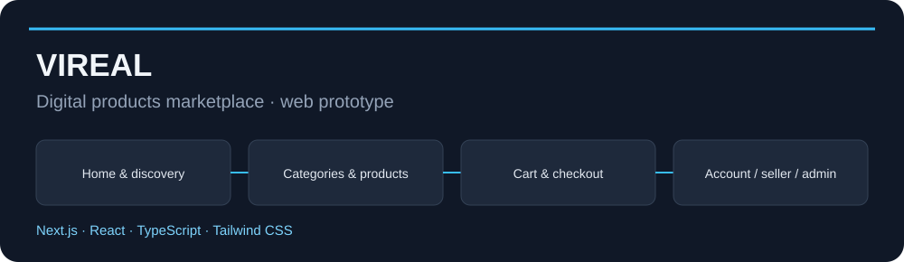

<div align="center">

# VIREAL



**Digital products marketplace · web prototype**

Next.js · React · TypeScript · Tailwind CSS

</div>

## Overview

A digital-product storefront prototype with a dark, responsive interface. The homepage uses mock product, category and testimonial data to demonstrate discovery and merchandising.

## Experience
- Trending products, featured listings and new arrivals.
- Dedicated category and product routes.
- Cart, checkout, authentication and account screens.
- Seller, admin and assistant routes for exploring marketplace workflows.

## Architecture
The Next.js App Router organizes screens under `app/`. Reusable UI and storefront components live in `components/`, with shared utilities in `lib/`.

## Run locally
```bash
pnpm install
pnpm dev
```
Open http://localhost:3000. Use `pnpm build` for a production build.

## Scope
This is a marketplace prototype; mock listings are not real sales. Payment processing, authentication security and production readiness are not established by this documentation.
